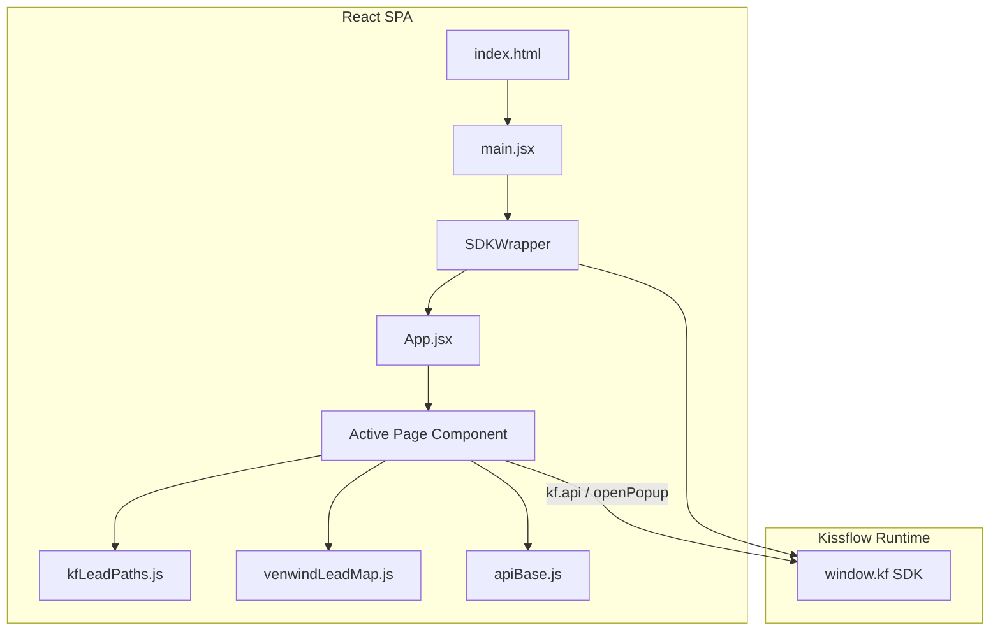

# Venwind Kissflow Lead Components

A collection of **Kissflow custom Page components** for **Venwind Sales / Lead Tracker** (`Vindview_Sales_Management_A00`), built with **React 18**, **Vite**, and **Tailwind CSS v4**.

Each page is a self-contained SPA that runs inside Kissflow using the [`@kissflow/lowcode-client-sdk`](https://www.npmjs.com/package/@kissflow/lowcode-client-sdk). You build **one page at a time**, zip the output, and upload it as a Kissflow **Page** app.

This repository is a **production-ready starting point** for Venwind lead dashboards, My Items / My Tasks inboxes, and mock analytics reports — with Kissflow API wiring, popup integration, role-based filtering, and a cohesive Venwind UI theme.

**Repository:** [github.com/raghulje/Venwind_KF_Lead_Component](https://github.com/raghulje/Venwind_KF_Lead_Component)

---

## Table of contents

- [What is included](#what-is-included)
- [Architecture](#architecture)
- [Tech stack](#tech-stack)
- [Prerequisites](#prerequisites)
- [Quick start](#quick-start)
- [Choosing which page to build](#choosing-which-page-to-build)
- [Building for Kissflow](#building-for-kissflow)
- [Uploading to Kissflow](#uploading-to-kissflow)
- [Project structure](#project-structure)
- [How Kissflow integration works](#how-kissflow-integration-works)
- [Environment variables](#environment-variables)
- [Page components in detail](#page-components-in-detail)
- [Shared modules](#shared-modules)
- [UI and UX conventions](#ui-and-ux-conventions)
- [Customizing for your tenant](#customizing-for-your-tenant)
- [Troubleshooting](#troubleshooting)
- [Scripts reference](#scripts-reference)
- [Contributing](#contributing)

---

## What is included

This repo ships **four Kissflow Page components**. Only **one** is active at build time (controlled in `src/App.jsx`).

| Component | File | Kissflow APIs | Description |
|-----------|------|---------------|-------------|
| **VWMyItemsMyTasksPage** | `VWMyItemsMyTasksPage.jsx` | My Items, My Tasks, pending, participated, user | Lead hub — **My Tasks**, **My Leads**, **Participated** tabs, Venwind accordion, `openPopup` for create/view. |
| **VWLeadDashboard** | `VWLeadDashboard.jsx` | Admin lead list, user profile, workflow progress | Executive dashboard — KPI cards, Recharts trends, latest leads table, date-range filters, role-based lead access. |
| **VWReportsMockHubPage** | `VWReportsMockHubPage.jsx` | User profile (greeting) | Full reports shell (greeting + toolbar) wrapping mock analytics sections. |
| **VWReportsMockPage** | `VWReportsMockPage.jsx` | SDK user (greeting only) | Mock report KPIs and tables — usable standalone or embedded inside `VWReportsMockHubPage`. |

### Kissflow process context

| Concept | Typical technical id |
|---------|-------------------|
| Lead Tracker application | `Lead_Trcaker_A00` |
| Venwind sales process | `Vindview_Sales_Management_A00` |
| Hub `_application_id` query | `Vindview_Sales_Management_A00` |
| Dashboard admin `_application_id` | `Lead_Trcaker_A00` (via `VITE_KF_VENWIND_APPLICATION_ID`) |

### Build output

A successful build produces:

```
dist/
├── index.html
├── manifest.json      ← { "Category": "Page", "Framework": "React" }
└── assets/
    ├── index-*.css
    └── index-*.js
```

The `npm run zip` script packages `dist/` into a zip file named after the active component (e.g. `VWLeadDashboard.zip`).

---

## Architecture



**Runtime flow:**

1. Kissflow loads `index.html` inside a Page app iframe.
2. `SDKWrapper` initializes `@kissflow/lowcode-client-sdk` (or uses `window.kf` if already present).
3. `App.jsx` renders exactly **one** root page component.
4. That component reads account / process / application ids from the SDK (with `.env` fallbacks for local dev).
5. Data is fetched via `kf.api()` (preferred) or `fetch(getApiBase() + path)` as fallback.
6. User actions (view lead, create lead) call `kf.app.page.openPopup(...)`.

---

## Tech stack

| Layer | Choice |
|-------|--------|
| Framework | React 18 |
| Bundler | Vite 5 |
| Styling | Tailwind CSS v4 (`@tailwindcss/vite`) |
| Charts | Recharts (dashboard) |
| Animations | AOS |
| Icons | Lucide React + Remix Icon (CDN) |
| Kissflow | `@kissflow/lowcode-client-sdk` |
| Fonts | Plus Jakarta Sans (CDN) |

---

## Prerequisites

- **Node.js** `^18.0.0` or `>=20.0.0` (see `package.json` → `engines`)
- **npm** (recommended — used by the zip script)
- A Kissflow account with:
  - Lead Tracker application hosting `Vindview_Sales_Management_A00`
  - Popup ids for lead create / view flows
  - Appropriate user roles for My Items / admin list access

Optional for local HTTPS dev:

- TLS cert/key in `cert/localhost.crt` and `cert/localhost.key` (referenced by `vite.config.js`)

---

## Quick start

### 1. Clone and install

```bash
git clone https://github.com/raghulje/Venwind_KF_Lead_Component.git
cd Venwind_KF_Lead_Component
npm install
```

### 2. Configure environment (local preview)

Copy the example env file and adjust ids for your Kissflow tenant:

```bash
cp .env.example .env
```

When running **inside Kissflow**, most ids are read automatically from `window.kf`. The `.env` file is mainly for **local Vite dev** when the SDK is unavailable.

### 3. Choose your page

Edit `src/App.jsx` — uncomment **one** component and comment out the rest:

```jsx
function App() {
    return (
        <div className="rootDiv">
            {/* <VWMyItemsMyTasksPage /> */}
            <VWLeadDashboard />
            {/* <VWReportsMockHubPage /> */}
            {/* <VWReportsMockPage /> */}
        </div>
    )
}
```

### 4. Run locally

```bash
npm run dev
```

Open the URL Vite prints (HTTPS on `0.0.0.0` if certs are present). Outside Kissflow you will see a yellow **Preview mode** banner — the UI still renders, but live API calls need the SDK or correct env fallbacks.

### 5. Build and zip for Kissflow

```bash
npm run zip
```

This runs `npm run build`, then creates a zip at the project root (e.g. `VWLeadDashboard.zip`).

---

## Choosing which page to build

The zip script (`scripts/zip.js`) **auto-detects** the active component in `App.jsx`:

1. Parses import names from `App.jsx`
2. Finds the first uncommented `<ComponentName />` tag in the JSX return
3. Names the zip accordingly (e.g. `VWLeadDashboard.zip`)

**Supported root components:**

- `VWMyItemsMyTasksPage`
- `VWLeadDashboard`
- `VWReportsMockHubPage`
- `VWReportsMockPage`

> **Tip:** Build and upload **one zip per Kissflow Page app**. If you need all four pages in Kissflow, create four separate Page apps — each with its own `App.jsx` selection and zip.

| Build this page | Set in `App.jsx` |
|-----------------|------------------|
| Lead hub (My Tasks / My Leads) | `<VWMyItemsMyTasksPage />` |
| Analytics dashboard | `<VWLeadDashboard />` |
| Mock reports (full shell) | `<VWReportsMockHubPage />` |
| Mock reports (content only) | `<VWReportsMockPage />` |

---

## Building for Kissflow

### Production build only

```bash
npm run build
```

Output goes to `dist/`. The Vite plugin automatically writes `dist/manifest.json`:

```json
{
  "Category": "Page",
  "Framework": "React"
}
```

### Important Vite settings

From `vite.config.js`:

- **`base: ''`** — relative asset paths so the bundle works inside Kissflow’s CDN hosting
- **`target: 'es2022'`** — modern browsers supported by Kissflow Page runtime
- **Manifest plugin** — required for Kissflow to recognize the upload as a React Page

---

## Uploading to Kissflow

1. Run `npm run zip` for the page you want.
2. In Kissflow, go to **Admin** → **Apps** → create or open a **Page** app.
3. Upload the generated zip (e.g. `VWLeadDashboard.zip`).
4. Publish the app and add it to a portal or menu.
5. Open the page **inside Kissflow** (not just the raw CDN URL) so `window.kf` is available.

### What Kissflow expects in the zip

| File | Required | Purpose |
|------|----------|---------|
| `index.html` | Yes | Entry HTML |
| `manifest.json` | Yes | Declares Page + React |
| `assets/*` | Yes | Bundled JS/CSS |

Do **not** commit `.env`, credentials, or zip files to git (see `.gitignore`).

---

## Project structure

```
Venwind_KF_Lead_Component/
├── index.html                 # Vite entry (fonts, icons)
├── package.json
├── vite.config.js             # Build + manifest.json emission
├── postcss.config.cjs
├── .env.example               # Documented env fallbacks
├── scripts/
│   └── zip.js                 # Build + zip for Kissflow upload
├── cert/                      # Optional local HTTPS certs (gitignored)
└── src/
    ├── App.jsx                # Single active page selector
    ├── main.jsx               # React root + SDKWrapper
    ├── index.css              # Tailwind + Venwind theme
    │
    ├── VWMyItemsMyTasksPage.jsx   # Lead hub (Page entry)
    ├── VWLeadDashboard.jsx        # Dashboard (Page entry)
    ├── VWReportsMockHubPage.jsx   # Mock reports hub (Page entry)
    ├── VWReportsMockPage.jsx      # Mock reports body
    │
    ├── LeadsManagementPage.jsx    # Hub tabs: tasks / items / participated
    ├── KPICards.jsx               # KPI strip (shared)
    ├── LeadTrends.jsx             # Area chart
    ├── LeadByDayOfWeek.jsx        # Bar chart
    ├── LeadManagementExpandPanel.jsx
    ├── MobileLeadCards.jsx
    ├── MobileTaskCards.jsx
    │
    ├── apiBase.js             # Tenant URL resolution for fetch()
    ├── kfLeadPaths.js         # Venwind + lead API path builders
    ├── leadPopupIds.js        # Popup ids + activity instance helpers
    ├── leadWorkflowUi.js      # Workflow steps, follow-up formatting
    ├── leadRowEnrich.js       # Row hydration helpers
    ├── leadAccordionApi.js    # Detail + progress GET
    ├── leadAccordionHydration.js
    ├── participatedLeads.js   # Participated tab APIs
    ├── slaMeta.js             # SLA deadline display helpers
    │
    ├── lib/
    │   ├── kfLeadDashboard.js # Access filter, admin fetch helpers
    │   ├── kfLeadPaths.js     # Path builders for lib layer
    │   └── kfRuntime.js       # kfGetJson, account resolution
    │
    ├── venwind/
    │   ├── venwindLeadMap.js  # Kissflow item → lead row mapping
    │   ├── theme/ui.js        # Buttons, tables, badges
    │   └── components/        # Hub chrome, tables, accordion, KPIs
    │
    ├── hooks/
    │   └── useMediaQuery.js
    └── sdk/
        ├── index.js
        ├── wrapper.jsx        # SDK init + preview banner
        └── context.jsx        # KissflowSDKContext
```

---

## How Kissflow integration works

### SDK initialization

`src/sdk/wrapper.jsx`:

- Uses `window.kf` if Kissflow already injected it
- Otherwise calls `KFSDK.initialize()` from `@kissflow/lowcode-client-sdk`
- Provides `{ kf, sdkReady }` via `KissflowSDKContext`
- Shows a non-blocking banner when SDK init fails (local preview)

Page components access the SDK like this:

```jsx
import { kf, KissflowSDKContext } from './sdk/index.js'

const { kf: kfFromContext, sdkReady } = useContext(KissflowSDKContext)
const kfInstance = kfFromContext ?? window.kf ?? kf
```

### API calls

**Preferred:** `kf.api(path, { method, headers: { Accept: 'application/json' } })`

**Fallback:** `fetch(getApiBase() + path, { credentials: 'include', ... })`

`apiBase.js` resolves the correct tenant origin. It avoids using the `resource.*.kissflow.store` CDN host for API calls (which causes 404/CORS issues).

### Path builders

`kfLeadPaths.js` centralizes Kissflow REST paths:

| Function | Use case |
|----------|----------|
| `resolveKfAccountId(kf)` | Account id for `/process/2/{account}/...` |
| `buildVenwindProcessApiPaths(kf)` | Hub — My Items / Tasks / user (`_application_id=Vindview_Sales_Management_A00`) |
| `buildVenwindAdminApiPaths(kf)` | Dashboard — admin lead list |
| `buildVenwindHubAdminApiPaths(kf)` | Hub admin paths paired with process paths |
| `buildLeadProcessApiPaths(kf)` | Generic lead process paths (overridable) |
| `buildLeadAdminApiPaths(kf)` | Admin item list + count |

### User greeting API

Hub and dashboard pages load the signed-in user for the welcome row:

```
GET /user/2/{accountId}/{userId}?_application_id={applicationId}
```

Role display uses `kf.user.Role` from the SDK, with optional enrichment from the user GET response.

### Row mapping

`venwind/venwindLeadMap.js` normalizes raw Kissflow items into display-friendly lead rows:

- Customer, region, lead source, stage, owner
- Venwind-specific accordion sections (`VENWIND_HUB_ACCORDION_SECTION_TITLES`)
- List vs detail mapping (`mapVenwindKfItemToLead`, `mapVenwindKfItemToLeadForList`)

List APIs often return **slim** rows. The hub and table components **hydrate** rows with detail GETs so accordions and columns show complete data.

### Popups

Create and view flows use Kissflow popups:

```js
kf.app.page.openPopup(VENWIND_LEAD_POPUP_ID, {
  InstanceId,
  ActivityInstanceId,
  ActivityId,
  activityId,
  width: 960,
  height: 720,
})
```

Default popup ids are in `src/leadPopupIds.js`:

| Constant | Purpose |
|----------|---------|
| `VENWIND_LEAD_POPUP_ID` | Venwind sales hub popup |
| `LEAD_TRACKER_POPUP_ID` | Legacy Lead Tracker popup |

Always wrap `openPopup` in try/catch — it may be unavailable in preview mode.

### Role-based dashboard access

`lib/kfLeadDashboard.js` provides `filterLeadsByAccess()` and `resolveAccessLevel()`:

- **Head / Manager / Admin** — see all leads from admin list
- **Sales rep** — leads filtered to owner / creator match

---

## Environment variables

All variables use the `VITE_` prefix (bundled into the client by Vite). Copy `.env.example` to `.env` and fill in **your own Kissflow tenant** values.

> **Important — your data stays yours**
>
> This repository is a **template / reference implementation**. It does **not** ship production secrets.
>
> - When the page runs **inside Kissflow**, ids are resolved from `window.kf` automatically.
> - For **local preview**, set the variables below in a private `.env` file (never commit `.env`).
> - Cloning this repo **will not connect to any tenant** unless you configure your own ids.

| Env variable | Purpose |
|--------------|---------|
| `VITE_KF_BASE_URL` | Kissflow tenant origin, e.g. `https://your-company.kissflow.com` |
| `VITE_KF_ACCOUNT_ID` | Account technical id |
| `VITE_KF_APPLICATION_ID` | Application id fallback |
| `VITE_KF_LEAD_PROCESS_ID` | Default lead process id |
| `VITE_KF_VENWIND_APPLICATION_ID` | Dashboard admin `_application_id` (often `Lead_Trcaker_A00`) |
| `VITE_KF_VENWIND_PROCESS_ID` | Venwind process id (`Vindview_Sales_Management_A00`) |

### Example `.env` (placeholders only)

```env
VITE_KF_BASE_URL=https://your-company.kissflow.com
VITE_KF_ACCOUNT_ID=your_kissflow_account_id
VITE_KF_APPLICATION_ID=
VITE_KF_LEAD_PROCESS_ID=Lead_tracker_1_A00
VITE_KF_VENWIND_APPLICATION_ID=Lead_Trcaker_A00
VITE_KF_VENWIND_PROCESS_ID=Vindview_Sales_Management_A00
```

### Security notes

- **Never** commit `.env`, API keys, or credential JSON files to git.
- Only **public** Kissflow technical ids belong in client-side env vars.
- Each team must use **their own** Kissflow tenant.

---

## Page components in detail

### VWMyItemsMyTasksPage

- **Purpose:** Primary lead work queue for Venwind sales users
- **Wraps:** `LeadsManagementPage` with Venwind shell (`VenwindPageShell`, `VenwindGreetingRow`)
- **Tabs:** My Tasks · My Leads · Participated
- **Features:**
  - Status count badges from Kissflow APIs
  - Search, date filters, pagination
  - Venwind accordion (`VWLeadAccordionPanel`) with **Show More** / **Hide**
  - Mobile card layouts
  - Row hydration for accordion detail
  - **+ New Lead** via `openPopup`
  - SLA chips (`slaMeta.js`)
- **When to use:** Day-to-day lead submission and task completion inside Kissflow

### VWLeadDashboard

- **Purpose:** Analytics and pipeline overview for managers and reps
- **Data sources:**
  - Admin lead list (`buildVenwindAdminApiPaths`)
  - User profile GET for greeting
  - Workflow progress on expanded rows
- **Features:**
  - Venwind KPI cards (total, today, week, closed, pending, sources)
  - Lead trends area chart + day-of-week bar chart
  - Insight cards + recent leads sidebar
  - Latest leads table with Venwind styling
  - Date range filter (Today / Last 7 Days / custom)
  - Role-based lead filtering
  - Demo fallback data when API returns empty (local dev)
- **When to use:** Executive or team dashboard Page app

### VWReportsMockHubPage

- **Purpose:** Analytics & reporting layout with full Venwind hub chrome
- **Data:** Embeds `VWReportsMockPage` (mock JSON — no live report APIs yet)
- **Features:** Greeting row, date range select, Export / Refresh toolbar
- **When to use:** Stakeholder demos of report UX before wiring real Kissflow report APIs

### VWReportsMockPage

- **Purpose:** Report sections only — KPIs + tables (user adoption, login activity, CRM usage, pipeline, sales performance, overdue follow-ups)
- **Modes:**
  - **Standalone** — includes its own `VenwindPageShell` + greeting
  - **Embedded** — passed `embedded` prop from `VWReportsMockHubPage`
- **When to use:** Iterate on report UI; swap mock data for `process-report` or custom APIs later

---

## Shared modules

| Module | Responsibility |
|--------|----------------|
| `apiBase.js` | Resolves Kissflow tenant base URL; CDN vs tenant origin handling |
| `kfLeadPaths.js` | Builds all Venwind lead REST paths from SDK + env |
| `venwind/venwindLeadMap.js` | Maps raw API items → lead table / accordion fields |
| `leadPopupIds.js` | Popup ids, activity instance extraction, popup param builder |
| `leadWorkflowUi.js` | Workflow steps, follow-up pills, audio player helpers |
| `leadAccordionApi.js` | Instance detail + progress GET |
| `leadAccordionHydration.js` | Merge detail into expanded row state |
| `participatedLeads.js` | Participated tab activity + row fetch |
| `slaMeta.js` | `useSlaDeadlineMeta`, `slaDeadlineTitle` for SLA UI |
| `lib/kfLeadDashboard.js` | Admin fetch, access filter, analytics helpers |
| `hooks/useMediaQuery.js` | `matchMedia` hook for responsive components |
| `venwind/theme/ui.js` | Shared Venwind table, button, badge classes |
| `sdk/` | SDK bootstrap, React context, `kf` export |

---

## UI and UX conventions

- **Theme:** Venwind teal palette (`#0F766E`, `#134E4A`), soft page shell with wind turbine motifs
- **Typography:** Plus Jakarta Sans
- **Icons:** Lucide React + Remix Icon (`ri-*` classes)
- **Layout:** Mobile-first; desktop restored with `sm:` / `md:` breakpoints
- **Touch targets:** `min-h-[44px]` on primary actions; `touch-manipulation`
- **Tables:** Sticky headers, Venwind pagination bar, expandable accordions
- **Charts:** Recharts inside `ResponsiveContainer`
- **Animations:** AOS scroll reveals on hub and dashboard sections
- **Accordions:** Tab pills in header row; **Show More** / **Hide** actions aligned with tabs

---

## Customizing for your tenant

### Step 1 — Map your Kissflow artifacts

In Kissflow Admin, note technical ids for:

| What you need | Typical artifact |
|---------------|------------------|
| Lead Tracker app | Application hosting Venwind process |
| Venwind process | `Vindview_Sales_Management_A00` (or your process name) |
| Lead popup id | Create / view lead popup |
| Account id | From account / API settings |

### Step 2 — Select the page in App.jsx

Uncomment the component you are shipping.

### Step 3 — Update popup ids

Edit `src/leadPopupIds.js` or add env overrides if you introduce `VITE_KF_*_POPUP_ID` variables.

### Step 4 — Field mapping

If your process uses different field names, update `venwind/venwindLeadMap.js` rather than scattering mapping logic in JSX.

### Step 5 — Build and upload

```bash
npm run zip
```

Upload to a new or existing Kissflow Page app.

---

## Troubleshooting

| Symptom | Likely cause | Fix |
|---------|--------------|-----|
| Yellow “Preview mode” banner | SDK not available (local dev) | Open inside Kissflow Page app |
| API 404 on `resource.*.kissflow.store` | API called against CDN host | Use `getApiBase()` — handled in `apiBase.js` |
| Empty tables in Kissflow | Wrong process/app ids | Verify env vars or SDK context; check Network tab |
| Admin sees no leads on dashboard | Role filter or wrong list API | Check `filterLeadsByAccess`; verify admin list path |
| `openPopup` does nothing | Wrong popup id or missing instance ids | Confirm `VENWIND_LEAD_POPUP_ID`; pass `InstanceId` + activity aliases |
| Zip has wrong name | Multiple uncommented components in App.jsx | Only one `<Component />` should be active |
| HTTPS dev server fails | Missing `cert/` files | Add localhost cert/key or remove `server.https` from `vite.config.js` |
| Greeting shows “User” | User GET failed | Confirm `/user/2/{account}/{userId}` path and SDK user id |

### Debug tips

1. Open browser DevTools → **Network** while running inside Kissflow.
2. Log `window.kf`, `kf.user`, and paths from `buildVenwindProcessApiPaths(kf)`.
3. Compare API responses to `venwindLeadMap.js` field expectations.
4. Test one page at a time — do not uncomment multiple roots in `App.jsx`.

---

## Scripts reference

| Command | Description |
|---------|-------------|
| `npm run dev` | Start Vite dev server (HTTPS if certs exist) |
| `npm run build` | Production build → `dist/` |
| `npm run preview` | Serve `dist/` locally |
| `npm run zip` | Build + create Kissflow upload zip |

---

## Contributing

Contributions are welcome. When adding a new Kissflow Page component:

1. Create the component under `src/` with a clear `VW*` name
2. Import it in `App.jsx`
3. Document any new `VITE_KF_*` variables in `.env.example`
4. Keep API path logic in `kfLeadPaths.js` (not inline in JSX)
5. Match existing SDK, popup, and Venwind UI patterns

Please do not commit `.env`, `*.zip`, `node_modules/`, or credentials.

---

## License

This project is licensed under the [MIT License](LICENSE).
